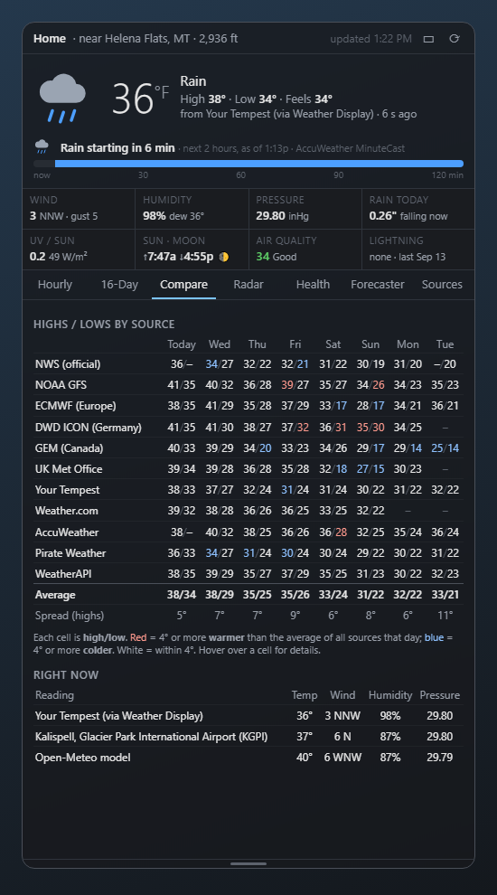
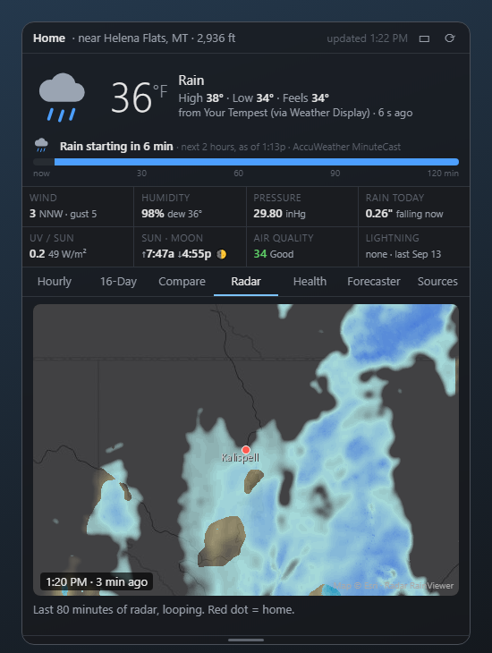

# WeatherDial

One see-through weather panel for the Windows desktop. It pulls the forecast for your exact
spot from up to 15 sources, shows how far they agree, and puts your own weather station's
live readings on top.

## What it shows

- **Now:** your own station (Tempest) if you have one, else the nearest official station,
  else the model. Shows wind and gusts, humidity and dew point, pressure and its 3-hour trend,
  rain today, UV and solar, sunrise and sunset, moon, air quality and lightning.
- **Warnings:** National Weather Service alerts appear as a red banner. Click it to read the
  full alert and what to do.
- **Hourly:** a 48-hour or 7-day chart. It shows the forecast line (the official NWS forecast
  where it has one), a shaded band for the range of all sources, feels-like (dotted),
  chance of rain or snow (blue bars for rain, white for snow), wind, night shading and the
  freezing line.
- **16-Day:** the average of all sources for each day, with a coloured dot for how well they
  agree.
- **Compare:** every source's highs and lows side by side, plus the current readings from
  your station, the nearest airport and the model.
- **Radar:** an animated loop of the last 80 minutes, starting on the newest frame.
- **Forecaster:** the written forecast discussion from your NWS office.
- **Sources:** which sources are working, with sign-up links for the optional keys.
- **Compact mode:** just current conditions plus 4 days.

| 16-Day | Compare sources | Radar |
|---|---|---|
|  |  |  |

| Forecaster's discussion | Sources | Compact mode |
|---|---|---|
|  |  |  |

### Hidden extras

| Click a day (16-Day) | Hover the hourly chart | Hourly: 7 days | Right-click menu |
|---|---|---|---|
|  |  |  |  |

- **Click a day** in 16-Day for the NWS day and night forecast text, sun times, UV, snow and
  rain amounts, gusts, and every source's numbers for that day. Click it again to close it.
- **Hover** the hourly chart to see that hour's details and each source's temperature.
- **Hover a cell** in Compare to see how far that source is from the average. Hover the
  Average and Spread rows for what they mean.
- **Hover the agreement dot** in 16-Day to see the warmest and coldest highs and how many
  sources there are.
- **Hover the Lightning box** to see the distance of the last strike.

## How it behaves

Like PCDials: drag it anywhere, on any monitor. It sits behind your other windows, never takes
focus (safe while gaming), and has no taskbar button, just a tray icon. It remembers its spot,
size and tab, hides while its monitor is off, and comes back when the monitor is on again.

## Install

1. Double-click **`Install.bat`**. It installs Python and pywebview if they're missing,
   creates `config.json` and `keys.json`, opens `config.json` for you, and starts the panel.
2. In `config.json`, set your location (see below).
3. Optional: add free keys for more sources (see **Sources**).
4. From then on, start it with **`Start.bat`**. Or right-click the tray icon and tick
   **Start with Windows**.

`Install.bat check` only reports what's installed and changes nothing.

## Settings: `config.json`

| Setting | What it does |
|---|---|
| `name` | The name shown top-left, e.g. `Home`. |
| `lat`, `lon` | Your location in decimal degrees. West longitudes are negative, e.g. `-114.3`. Tip: right-click your house in Google Maps and click the numbers to copy them. |
| `refresh_minutes` | How often the no-key sources (NWS and Open-Meteo) refresh, at least every 2 minutes. Keyed sources keep their own safe pace (see the table below), so this can't use up a key's daily limit. |
| `weather_display_dir` | Optional. The Weather Display folder, if Weather Display runs your station (see below). Leave it blank otherwise. |
| `source_minutes` | Optional. How often a particular source refreshes, overriding the pace in the table below, e.g. `{"AccuWeather": 10}`. Use the name shown in the Sources tab; the minimum is 2. Check that source's daily limit first. AccuWeather, for example, uses 2 requests per refresh, so every 10 minutes is about 288 a day. |

Right-click the panel → **Edit location…** to open the file. Your changes are used from the
next refresh.

## Using it

- **Move:** drag the top bar or the current-conditions area.
- **Taller or shorter:** drag the small handle on the bottom edge. Double-click it to fit the
  tab you're looking at exactly. The height is remembered and never goes past the screen.
- **Right-click** the panel for its menu: Lock position, Compact / Full size, Small / Medium /
  Large, Refresh now, Edit API keys…, Edit location…, Close WeatherDial.
- **The tray icon** (a sun and cloud) has the same options, plus **Start with Windows**.
- **Updates:** your station is re-read every 30 seconds. **Refresh now** won't download the
  same source more than once every 2 minutes.

## Sources

The no-key sources alone give 6 forecasts (NWS plus 5 global models); Open-Meteo's blend of
the models supplies the hourly detail but isn't counted twice. Each key you add is one more
forecast in the average.

| Source | Key (name in `keys.json`) | Gives | Refreshes |
|---|---|---|---|
| National Weather Service (api.weather.gov) | none | Official 7-day and hourly forecast, alerts, nearest station's readings, forecast discussion | `refresh_minutes` |
| Open-Meteo | none | NOAA GFS, ECMWF, DWD ICON, Canada GEM and UK Met Office models (up to 16 days), air quality, UV, sun times | `refresh_minutes`; models hourly, air quality every 30 min |
| RainViewer + Esri map | none | Radar | when you open the Radar tab |
| Weather Display (on this PC) | none | Your Tempest live: read from Weather Display's `sentwurapiddata.txt` | every 30 s |
| Tempest cloud | `tempest_token`: tempestwx.com → Settings → Data Authorizations → Create Token | Lightning, yesterday's rain, Tempest's own 10-day and hourly forecast | every 5 min |
| Weather.com | `weathercom`: free for Weather Underground station owners, at wunderground.com/member/api-keys | weather.com's 5-day forecast (this key doesn't include hourly or 7/10-day) | every 30 min |
| AccuWeather | `accuweather`: developer.accuweather.com (free trial, then paid plans) | 15-day and 72-hour forecast, depending on your plan | every 60 min (2 requests each, ~48 a day). The trial allows 500 a day and paid plans more, so set `source_minutes` to refresh it faster. |
| Pirate Weather | `pirateweather`: free at pirate-weather.apiable.io | 8-day and hourly forecast | every 30 min |
| WeatherAPI.com | `weatherapi`: free at weatherapi.com | 14-day and hourly forecast (3 days on the free plan after the trial) | every 30 min |
| Visual Crossing | `visualcrossing`: free at visualcrossing.com | 15-day and hourly forecast | every 60 min |
| Tomorrow.io | `tomorrowio`: free at tomorrow.io | About 5-day and hourly forecast | every 30 min |

**Adding a key:** right-click the panel → **Edit API keys…**, paste the key between the
quotes, and save. It's used from the next refresh. To stop using a source, clear its key.
`config.json` and `keys.json` stay on your PC and are never uploaded (they're git-ignored).

**When a key stops working** (an expired trial, or a daily limit reached), the **Sources** tab
says so ("key refused: expired trial or wrong key?" or "too many requests today"). The panel
keeps working with the other sources. If a source fails briefly, its last good forecast stays
in use and the source shows yellow.

**Tempest and Weather Display:** only one program can listen to the Tempest hub's local
broadcast (UDP port 50222). If Weather Display already does, set `weather_display_dir`.
WeatherDial then reads the live values from the file Weather Display writes every few
seconds, with no clash and no firewall prompt. Lightning isn't in that file; the Tempest cloud
token adds it. The pressure trend (rising, falling or steady) appears after WeatherDial has
been running for about 2½ hours.

**Weather.com** gives its free key only to people whose weather station uploads to Weather
Underground. Weather Display can do that upload for you.

## How the numbers are worked out

- **Daily high and low** = the average of every source that forecasts that day. Every
  source's low is the *calendar-day* low (that morning). AccuWeather gives the following
  night's low instead, so its lows are moved to the next day to line up.
- **Agreement dot** (16-Day): green when all sources' highs and lows are within 5°, yellow
  within 10°, red when they're further apart. A red dot means the forecast is uncertain.
- **Thin marks on a 16-Day bar:** the coldest low and the warmest high that any source
  predicts.
- **Compare colours:** each cell is high/low. A **red** number is 4° or more **warmer** than
  that day's average; a **blue** one is 4° or more **colder**. White is within 4°.
- **Spread (highs):** the warmest minus the coldest high for that day.
- **Hourly line:** the NWS hourly forecast where it has one (about 6 days), then Open-Meteo's
  blend. The shaded band is the range of all sources for that hour.

## Troubleshooting

- **Panel not showing:** it sits behind other windows. Minimize them or press Win+D. Look
  for the sun-and-cloud icon in the tray (it may be under the tray's ^ arrow).
- **A source is red or grey in Sources:** grey means no key; red shows the reason next to it.
- **It closed by itself:** see `weatherdial.log` in the WeatherDial folder.
- **Starting a second copy** does nothing; only one runs at a time.

## Files

- `app.py`: the desktop panel (window, tray icon, local server on port 8791).
- `weather.py`: fetches every source and works out the averages. Run `python weather.py`
  to test them from a console.
- `panel.html`: the panel itself.
- `python app.py --server`: a preview in a normal browser at
  http://127.0.0.1:8791/panel.html?preview (only while the panel isn't running).
- `config.example.json`, `keys.example.json`: templates that `Install.bat` copies.
- `data/`: cached downloads (made by the app).
- `positions.json`: where the panel sits and its size, tab and settings (made by the app).
- `weatherdial.log`: messages and errors when it runs without a console.

## Requirements

Windows 10 or 11, Python 3.13 or newer, and [pywebview](https://pywebview.flowrl.com/).
`Install.bat` installs both if they're missing.

## License

MIT. See [LICENSE](LICENSE).
