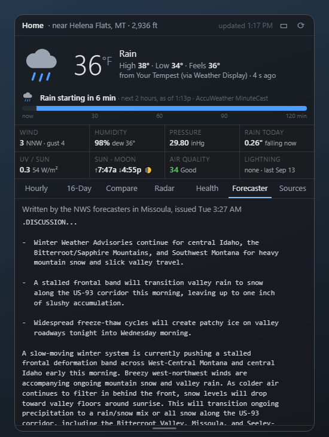
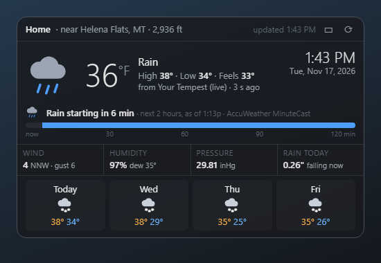
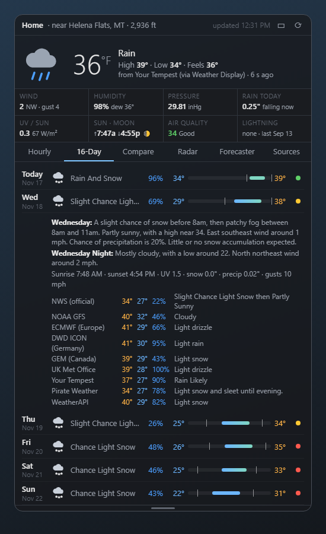
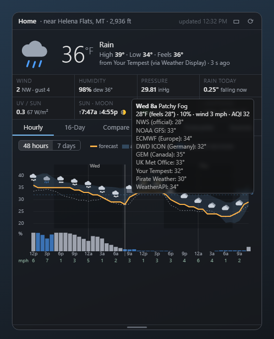
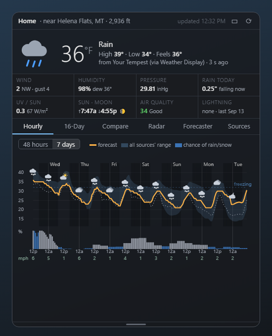

# WeatherDial

One see-through weather panel for the Windows desktop. It pulls the forecast for your exact
spot from many sources, shows how far they agree, and puts your own weather station's live
readings on top.

| 16-Day | Compare sources | Radar |
|---|---|---|
|  |  |  |

| Forecaster's discussion | Sources | Compact mode |
|---|---|---|
|  |  |  |

**Hidden extras**

| Click a day (16-Day) | Hover the hourly chart | Hourly: 7 days | Right-click menu |
|---|---|---|---|
|  |  |  |  |

- **Click a day** in 16-Day for the NWS day and night forecast text, sun times, UV, snow, rain,
  gusts and every source's numbers for that day.
- **Hover** the hourly chart for that hour's details and each source's temperature.
- **Hover a cell** in Compare to see how far that source is from the average.
- **Click a warning banner** to read the full NWS alert and what to do.

- **Now:** your station (Tempest), else the nearest official station, else the model.
  Wind and gusts, humidity and dew point, pressure and its 3-hour trend, rain today, UV and
  solar, sunrise and sunset, moon, air quality, lightning.
- **Warnings:** National Weather Service alerts appear as a red banner. Click it to read them.
- **Hourly:** a 48-hour or 7-day chart. It shows the forecast line, a band for the range of
  all sources, feels-like, chance of rain or snow, wind, night shading and the freezing line.
  Hover over it for each source's value.
- **16-Day:** the average of all sources, with a coloured dot showing how well they agree.
  Click a day for the NWS text and each source's numbers.
- **Compare:** each source's highs and lows side by side, plus the current readings from
  your station, the airport and the model.
- **Radar:** an animated loop of the last 80 minutes.
- **Forecaster:** the NWS forecasters' own written discussion.
- **Sources:** what's working, and sign-up links for the optional keys.

It behaves like PCDials: you drag it anywhere, it sits behind your windows, never takes focus
(safe while gaming), has no taskbar button (just a tray icon), and remembers its spot. It
hides while its monitor is off and comes back when the monitor is on again.

## Install

1. Double-click **`Install.bat`**. It installs Python and pywebview if they're missing,
   creates `config.json` and `keys.json`, and starts the panel.
2. In `config.json`, set your `lat` / `lon` (decimal degrees; west longitudes are
   negative, e.g. `-114.3`).
3. Afterwards, use **`Start.bat`**. Or right-click the tray icon and tick
   **Start with Windows**.

## Using it

- **Move:** drag the top bar or the current-conditions area.
- **Taller or shorter:** drag the small handle on the bottom edge. Double-click it to fit the
  tab you're looking at exactly. The height is remembered and never goes past the screen.
- **Right-click** the panel for its menu: Lock position, Compact / Full size, Small /
  Medium / Large, Refresh now, Edit API keys, Edit location, Close.
- The **tray icon** (sun and cloud) has the same menu, plus **Start with Windows**.
- Your station is re-read every 30 seconds. Each forecast source refreshes at its own pace,
  well inside its free limits. **Refresh now** won't download the same source more than
  once every 2 minutes.

## Sources

| Source | Key | Gives |
|---|---|---|
| National Weather Service (api.weather.gov) | none | official forecast, hourly forecast, alerts, nearest station, forecast discussion |
| Open-Meteo | none | NOAA GFS, ECMWF, DWD ICON, Canada GEM and UK Met Office models (up to 16 days), air quality, UV, sun times |
| RainViewer + Esri map | none | radar |
| Weather Display (on this PC) | none | your Tempest live, read from Weather Display's `sentwurapiddata.txt`. Set `weather_display_dir` in config.json. |
| Tempest cloud | free personal token: tempestwx.com → Settings → Data Authorizations | lightning, yesterday's rain, Tempest's own forecast |
| Pirate Weather | free key | forecast |
| WeatherAPI.com | free key | forecast (3 days on the free plan after the trial) |
| Visual Crossing | free key | forecast |
| Tomorrow.io | free key | forecast |

**Tempest and Weather Display:** only one program can listen to the Tempest hub's local
broadcast (UDP port 50222). If Weather Display already does, WeatherDial reads the live values
from the file Weather Display writes every few seconds, so there's no clash and no firewall
prompt. Lightning isn't in that file; the Tempest cloud token adds it.

**How the average works:** each day's high and low is the average of every source that
forecasts that day. Lows are the calendar-day low (that morning), for every source. The dot
shows agreement: green when the sources are within 5°, yellow within 10°, red beyond that.
In **Compare**, each cell is high/low. A **red** number is 4° or more **warmer** than that
day's average; a **blue** one is 4° or more **colder**.

To add or change a key, right-click the panel → **Edit API keys…**, paste it, and save.
`config.json` and `keys.json` stay on your PC and are never uploaded (they're git-ignored).

## Files

- `app.py`: the desktop panel (window, tray icon, local server on port 8791).
- `weather.py`: fetches every source and works out the averages. Run `python weather.py`
  to test from a console.
- `panel.html`: the panel itself.
- `python app.py --server`: preview in a normal browser at http://127.0.0.1:8791/panel.html?preview
  (only while the panel itself isn't running).
- `data/`: cached downloads (made by the app).
- `weatherdial.log`: messages and errors when started without a console.

## Requirements

Windows 10 or 11, Python 3.13 or newer, and [pywebview](https://pywebview.flowrl.com/).
`Install.bat` installs both if they're missing.

## License

MIT. See [LICENSE](LICENSE).
