# WeatherDial

One see-through weather panel for the Windows desktop. It pulls the forecast for your exact
spot from up to 15 sources, shows how far they agree, and puts your own weather station's
live readings on top.

Made for the US (the National Weather Service supplies warnings, the official forecast and the
forecasters' discussion). Elsewhere everything else still works.

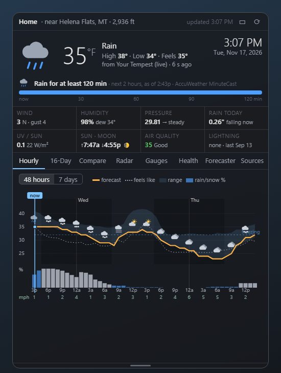

## What it shows

- **Clock:** the time and date at the top right.
- **Now:** your own station (Tempest) if you have one, else the nearest official station,
  else the model. Shows wind and gusts, humidity and dew point, pressure and its 3-hour trend,
  rain today, UV and solar, sunrise and sunset, moon, air quality and lightning.
  - Under the temperature: the **change over the last hour** (▲ red = warming, ▼ blue =
    cooling) and the feels-like temperature.
  - **Forecast** high / low for today (the average of all sources) and **So far**: the
    actual high / low your station has measured since midnight, with the times they
    happened. Hover for the exact readings.
  - The Pressure box also shows the **change over the last hour** (e.g. +0.012/hr); hover
    for the last hour and last 3 hours.
- **Warnings:** National Weather Service alerts appear as a red banner. Click it to read the
  full alert and what to do.
- **Next 2 hours** *(AccuWeather MinuteCast, optional)*: e.g. "Rain starting in 6 min", with
  a 2-hour bar (blue rain, white snow, purple ice).
- **Hourly:** a 48-hour or 7-day chart. It shows the forecast line (the official NWS forecast
  where it has one), a shaded band for the range of all sources, feels-like (dotted),
  chance of rain or snow (blue bars for rain, white for snow), wind, night shading and the
  freezing line. A blue **now** line (with a dot on the temperature line) marks the current
  moment.
- **16-Day:** the average of all sources for each day (weighted by accuracy, see below), with a coloured dot for how well they
  agree.
- **Compare:** every source's highs and lows side by side, plus the current readings from
  your station, the nearest airport and the model.
- **Accuracy** (Compare and Sources): a badge per source showing how close its next-day
  forecasts have come to what your own station measured, over a period you choose (default
  30 days). See *How accuracy is scored* below.
- **Radar:** an animated loop of the last 80 minutes, starting on the newest frame.
  ⏸ Pause / ▶ Play, ◀ ▶ to step one frame at a time, **Latest** to jump to the newest frame
  (pausing is remembered).
- **Gauges:** your station as instruments, in four styles (your choice is remembered):
  - *Barometer*: laid out like the classic Rainmeter "WeatherStation" barometer. A white
    aneroid face with *Stormy, Rain, Change, Fair, Very Dry* in Old English lettering,
    29 / 30 / 31 inches with half-inch "5"s, a millibar ring, and the "falling denotes
    weather deterioration / rising denotes weather improvement" text. The dark needle is the
    pressure now and the gold needle 24 hours ago. The red needle pivots below the centre on
    a °C / °F thermometer (today's low and high marked). Four corner dials show Feels like,
    Humidity, Wind and today's Precip.
  - *Dials*: temperature (today's low and high ticks), pressure (24 h and 3 h ago ticks and
    the 3-hour change), humidity with dew point, and a wind compass with gusts.
  - *Tubes*: a mercury thermometer (°F / °C, today's low and high arrows), a mercury
    barometer (inches / mb, 24 h and 3 h ago arrows) and a rain gauge (today's rain, with
    yesterday's total as a dashed line).
  - *24 h graphs*: pressure, temperature (low and high marked) and wind (average line, gust
    bars) for the last 24 hours. The temperature graph also has a **dotted line: the forecast
    made a day ahead** for each hour, with the average miss at the top right. Hover for the
    reading (and the forecast) at any time.
  - **ⓘ How to read** opens a short guide for the style shown, including what rising and
    falling pressure usually mean. The gauges grow with the panel when you make it bigger.
- **Health** *(AccuWeather indices, optional)*: today and the next 4 days for health
  (arthritis, sinus, migraine, asthma, COPD, cold, flu, dry skin, pollen, mold, dust) and for
  outdoors and home (hiking, hunting, fishing, skiing, snow days, driving, lawn mowing,
  composting, field readiness, soil moisture, mosquitoes, pests, clothes drying, stargazing,
  home energy, dog walking). Green is good for you or for that activity, yellow is so-so, red
  is poor or risky.
- **Forecaster:** the written forecast discussion from your NWS office.
- **Sources:** which sources are working, with sign-up links for the optional keys.
- **Compact mode:** just current conditions plus 4 days.

| 16-Day | Compare sources | Radar |
|---|---|---|
| 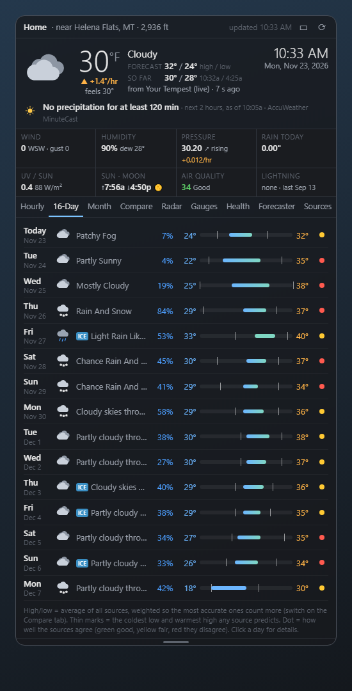 |  |  |

| Health (AccuWeather) | Forecaster's discussion | Sources |
|---|---|---|
| 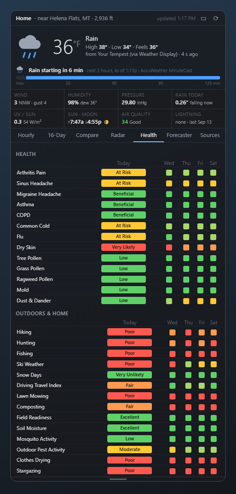 |  | 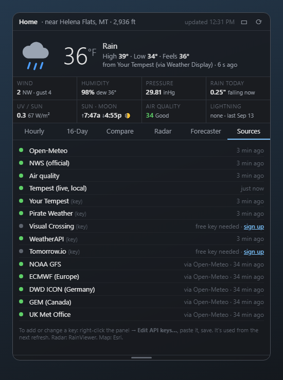 |

| Compact mode | Without the optional extras |
|---|---|
|  | 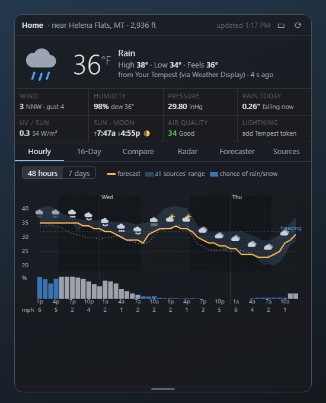 |

| Light theme, made wider |
|---|
| 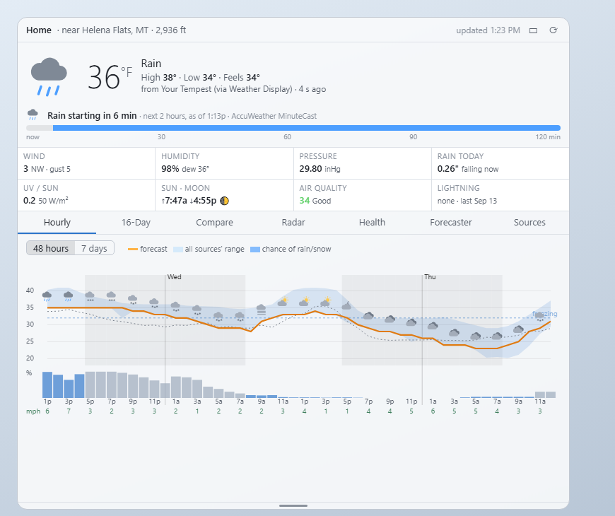 |

| Gauges: Barometer | Gauges: Dials (light) | Gauges: How to read |
|---|---|---|
| 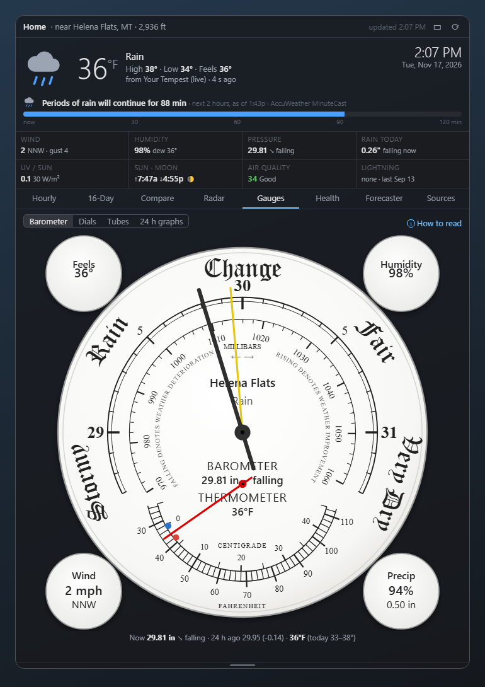 | 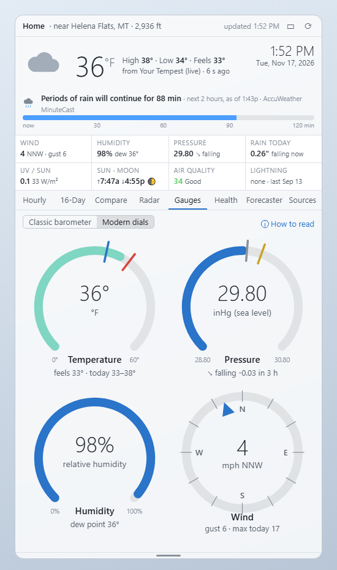 | 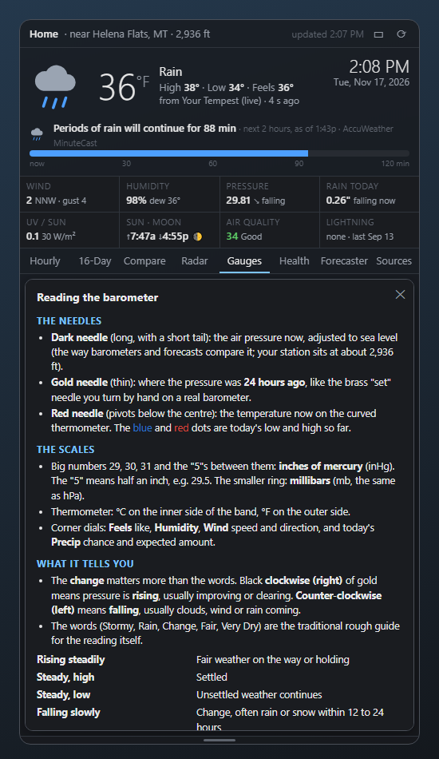 |

| Gauges: Tubes | Gauges: 24 h graphs |
|---|---|
| 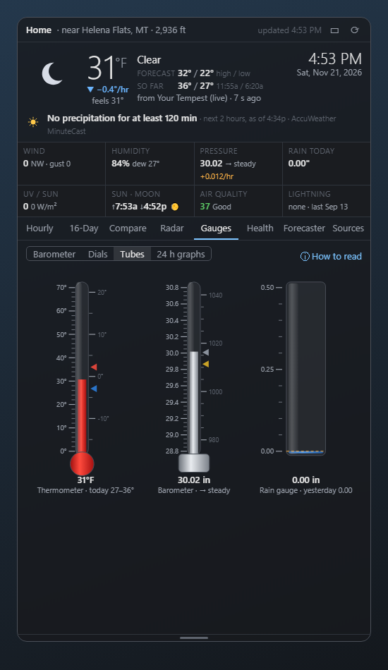 | 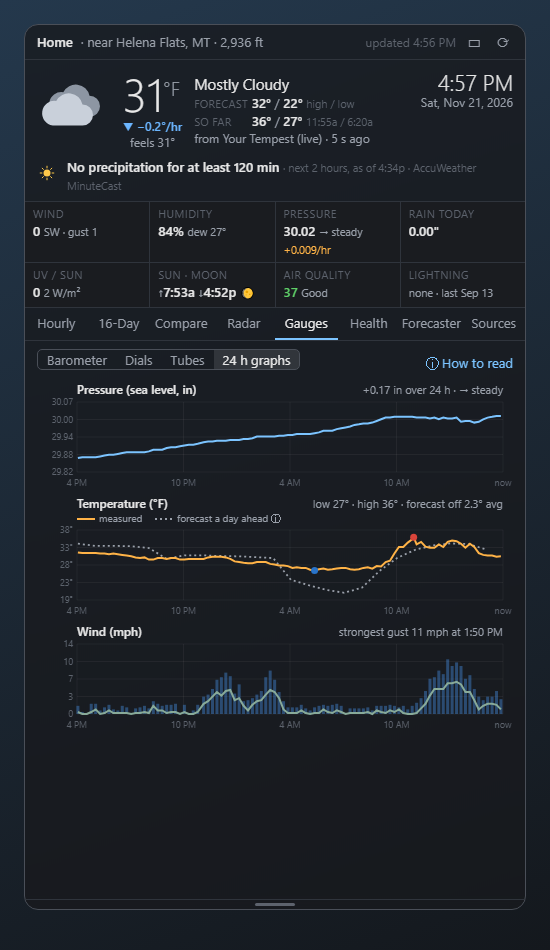 |

The optional parts (MinuteCast, Health, lightning and so on) appear only when their key
allows them. Without any keys the panel looks like the last picture and still works fully.

### Hidden extras

| Click a day (16-Day) | Hover the hourly chart | Hourly: 7 days | Right-click menu |
|---|---|---|---|
|  |  |  | 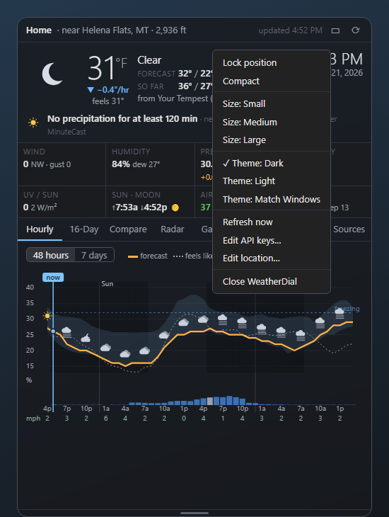 |

- **Click a day** in 16-Day for the NWS day and night forecast text, sun times, UV, snow and
  rain amounts, gusts, and every source's numbers for that day. Click it again to close it.
- **Hover** the hourly chart to see that hour's details and each source's temperature.
- **Hover a cell** in Compare to see how far that source is from the average. Hover the
  Average and Spread rows for what they mean.
- **Hover the agreement dot** in 16-Day to see the warmest and coldest highs and how many
  sources there are.
- **Hover the Lightning box** to see the distance of the last strike.
- **Hover the Wind box** to see today's and yesterday's highest wind and gust and when they
  happened. With the Tempest token this comes from your station's full history; without it,
  from what WeatherDial saw while running (it says so).
- **Hover Rain today** to see yesterday's rain (needs the Tempest token).
- **Hover a square** on the Health tab to see that day's rating.

## How it behaves

Drag it anywhere, on any monitor. It sits behind your other windows, never takes
focus (safe while gaming), and has no taskbar button, just a tray icon. It remembers its spot,
size and tab, hides while its monitor is off, and comes back when the monitor is on again.

## Install

1. Download the folder (or unzip it) somewhere permanent, e.g. `C:\WeatherDial`.
2. Double-click **`Install.bat`**. It installs Python and pywebview if they're missing, then
   asks a few questions:
   - **Your location:** in Google Maps, right-click your house, click the numbers at the top
     of the menu to copy them, and paste. It checks the spot with the National Weather
     Service and tells you the nearest town.
   - **Name** to show on the panel (e.g. Home, Cabin).
   - **Tempest token** (optional, only if you have a Tempest station): tempestwx.com →
     Settings → Data Authorizations → Create Token. It checks the token and finds your station.
   - **Tempest hub** on your home network? WeatherDial then listens to it for live readings.
   - **Extra forecast keys** (all optional; press Enter to skip each one).
3. The panel starts. **The first time, Windows may ask whether Python may use the network.
   Tick *Private networks* and click *Allow*.** That lets WeatherDial hear your Tempest hub.
4. From then on, start it with **`Start.bat`**, or right-click the tray icon and tick
   **Start with Windows**.

Run `Install.bat` again any time to change your answers (press Enter to keep each one).
`Install.bat check` only reports what's installed and changes nothing.

### If you have a Tempest weather station

- **Live readings (every few seconds):** WeatherDial listens to the Tempest hub on your home
  network, the same broadcast the Tempest app uses. No internet, no account and no other
  program needed. The PC just has to be on the same network as the hub.
- **With the token as well,** you also get lightning, yesterday's rain, today's strongest
  gust, the last 24 hours for the gauges and graphs, the accuracy scores straight away, and
  Tempest's own forecast as one more source.
- **No Weather Underground or Weather Display needed.** If you *do* run Weather Display, it
  already listens to the hub, so setup offers to read Weather Display's file instead.

## Settings: `config.json`

| Setting | What it does |
|---|---|
| `name` | The name shown top-left, e.g. `Home`. |
| `lat`, `lon` | Your location in decimal degrees. West longitudes are negative, e.g. `-114.3`. Tip: right-click your house in Google Maps and click the numbers to copy them. |
| `refresh_minutes` | How often the no-key sources (NWS and Open-Meteo) refresh, at least every 2 minutes. Keyed sources keep their own safe pace (see the table below), so this can't use up a key's daily limit. |
| `tempest_udp` | `true` = listen to a Tempest hub on the home network for live readings (set by setup). `false` = don't. |
| `tempest_station_id` | Your Tempest station (set by setup from your token). |
| `weather_display_dir` | Optional. The Weather Display folder, only if Weather Display runs your station (see below). |
| `tempest_udp_port` | Optional, default 50222: the port the Tempest hub broadcasts on. |
| `index_groups` | Optional. Which AccuWeather indices the Health tab shows, and in which groups, e.g. `{"Health": [21, 30, -14], "Outdoors": [3, 20, 13]}`. Run `python weather.py --indices` to list every index with its number. |
| `accuracy_backfill_days` | Optional, default 30. How many past days to fill in for the accuracy scores when you first start (the global models' past forecasts from Open-Meteo, and your Tempest's actual highs and lows). |
| `source_minutes` | Optional. How often a particular source refreshes, overriding the pace in the table below, e.g. `{"AccuWeather": 10}`. Use the name shown in the Sources tab; the minimum is 2. Check that source's daily limit first. AccuWeather, for example, uses 2 requests per refresh, so every 10 minutes is about 288 a day. |

Setup writes this file for you with **every setting listed** (the defaults for the ones it
didn't ask about) and a `_help` section at the bottom that explains each one. If a newer
version of WeatherDial adds a setting, it's added to your file with its default the next time
WeatherDial starts; your own values are never changed. The same goes for new key names in
`keys.json`.

To change settings, run `Install.bat` again, or right-click the panel → **Edit location…** to
open the file in Notepad. Changes to location and keys are used from the next refresh; changes
to the Tempest settings after restarting WeatherDial.

## Using it

- **Move:** drag the top bar or the current-conditions area.
- **Taller or shorter:** drag the small handle on the bottom edge. Double-click it to fit the
  tab you're looking at exactly. The height is remembered and never goes past the screen.
- **Wider or narrower:** drag the right edge (a handle appears when the mouse is over the
  panel). The hourly chart, radar map, 16-Day bars and tables stretch to fit, and the chart
  shows more hour labels when there's room. Double-click the handle for the normal width.
- **Light or dark:** right-click → **Theme: Dark / Light / Match Windows**. "Match Windows"
  follows Windows' own light/dark setting and changes with it. The radar map has a light
  and a dark version too.
- **Right-click** the panel for its menu: Lock position, Compact / Full size, Small / Medium /
  Large, Refresh now, Edit API keys…, Edit location…, Close WeatherDial.
- **The tray icon** (a sun and cloud) has the same options, plus **Start with Windows**.
- **Updates:** your station is re-read and the panel redrawn every 15 seconds (scrolled tabs keep their place, and the chart doesn't redraw while you hover over it). **Refresh now** won't download the
  same source more than once every 2 minutes.

## Sources

The no-key sources alone give 6 forecasts (NWS plus 5 global models); Open-Meteo's blend of
the models supplies the hourly detail but isn't counted twice. Each key you add is one more
forecast in the average.

| Source | Key (name in `keys.json`) | Gives | Refreshes |
|---|---|---|---|
| National Weather Service (api.weather.gov) | none | Official 7-day and hourly forecast, alerts, nearest station's readings, forecast discussion | `refresh_minutes` |
| Open-Meteo | none | NOAA GFS, ECMWF, DWD ICON, Canada GEM and UK Met Office models (up to 16 days), air quality, UV, sun times | `refresh_minutes`; models hourly, air quality every 30 min |
| RainViewer + Esri map | none | Radar | when you open the Radar tab |
| Your Tempest hub (home network) | none | Your station live: temperature, humidity, wind, pressure, rain, UV, lightning | every 15 s (the hub sends every 3 s to 1 min) |
| Weather Display (instead of the hub) | none | The same, read from Weather Display's `sentwurapiddata.txt` | every 15 s |
| Tempest cloud | `tempest_token`: tempestwx.com → Settings → Data Authorizations → Create Token | Lightning, yesterday's rain, the last 24 hours, Tempest's own 10-day and hourly forecast. Also the live readings if the hub can't be heard (every 5 min). | every 5 min |
| Weather.com | `weathercom`: free for Weather Underground station owners, at wunderground.com/member/api-keys | weather.com's 5-day forecast (this key doesn't include hourly or 7/10-day) | every 30 min |
| AccuWeather | `accuweather`: developer.accuweather.com (free trial, then paid plans) | 15-day and up to 120-hour forecast, depending on your plan (it checks once a day what the plan allows, so an upgrade is picked up automatically) | every 60 min (2 requests each, ~48 a day). The trial allows 500 a day and paid plans more, so set `source_minutes` to refresh it faster. |
| AccuWeather MinuteCast | same `accuweather` key; in the trial, then a paid add-on | Rain or snow minute by minute for the next 2 hours. Hidden if your plan doesn't include it. | every 30 min (~48 a day; the trial allows 50) |
| AccuWeather indices | same `accuweather` key | Health & lifestyle ratings for 5 days (Health tab). Hidden if your plan doesn't include it. | every 6 hours |
| Pirate Weather | `pirateweather`: free at pirate-weather.apiable.io | 8-day and hourly forecast | every 30 min |
| WeatherAPI.com | `weatherapi`: free at weatherapi.com | 14-day and hourly forecast (3 days on the free plan after the trial) | every 30 min |
| Visual Crossing | `visualcrossing`: free at visualcrossing.com | 15-day and hourly forecast | every 60 min |
| Tomorrow.io | `tomorrowio`: free at tomorrow.io | About 5-day and hourly forecast | every 30 min |

**Adding a key:** right-click the panel → **Edit API keys…**, paste the key between the
quotes, and save. It's used from the next refresh. To stop using a source, clear its key.
`config.json` and `keys.json` stay on your PC and are never uploaded (they're git-ignored).

**When a key stops working** (an expired trial, or a daily limit reached), the **Sources** tab
says so ("key refused: expired trial or wrong key?" or "too many requests today"). The panel
keeps working with the other sources. If a source fails briefly, its last good forecast stays
in use and the source shows yellow. A refused key is tried again only every 6 hours, and any
other failure at the source's normal pace, so a dead key never eats into a daily limit.
Sources shows when it will try again. MinuteCast and Health disappear by themselves when
AccuWeather stops allowing them, e.g. after a trial.

**Tempest hub and Weather Display:** only one program can listen to the Tempest hub's
broadcast (UDP port 50222). Normally that's WeatherDial. If Weather Display already does it,
setup offers to read Weather Display's file instead, with no clash and no firewall prompt.
Without the Tempest token, the pressure trend and the 24-hour gauges fill in from
WeatherDial's own readings, so give them a few hours after the first start.

**Weather.com** gives its free key only to people whose weather station uploads to Weather
Underground. Weather Display can do that upload for you.

## How the numbers are worked out

- **Daily high and low** = the average of every source that forecasts that day, weighted by
  accuracy unless you switch that off. Every
  source's low is the *calendar-day* low (that morning). AccuWeather gives the following
  night's low instead, so its lows are moved to the next day to line up.
- **Agreement dot** (16-Day): green when all sources' highs and lows are within 5°, yellow
  within 10°, red when they're further apart. A red dot means the forecast is uncertain.
- **Thin marks on a 16-Day bar:** the coldest low and the warmest high that any source
  predicts.
- **Compare colours:** each cell is high/low. A **red** number is 4° or more **warmer** than
  that day's average; a **blue** one is 4° or more **colder**. White is within 4°.
- **Spread (highs):** the warmest minus the coldest high for that day.
- **Hourly line:** the NWS hourly forecast where it has one (about 6 days), then Open-Meteo's
  blend. The shaded band is the range of all sources for that hour.

## How accuracy is scored

- Every few minutes WeatherDial saves each source's forecast for the next 5 days. The one a
  source made **the day before** a date is its *next-day forecast* for that date.
- After each day ends, it records the **actual** high and low your station measured: from the
  Tempest cloud history if you have the token (complete, minute by minute), otherwise from
  WeatherDial's own readings, but only if it ran all day with no gap over an hour.
- The badge is the average miss over the period you pick: **±3.3°** means that source's
  next-day high and low were 3.3° off on average. Lower is better. The colour shows its rank
  among the sources over that period: green is the most accurate, red the least.
- **Hover a badge** for details: the miss on highs and lows separately, whether that source
  tends to run warm or cold at your place, and its rank. Hover **Accuracy ⓘ** for an
  explanation.
- **Choose the period** with the *over the last … days* box (7, 14, 30, 60, 90, 180 or 365;
  default 30). Your choice is remembered.
- **Getting started:** the five global models are filled in at once for the last 30 days from
  Open-Meteo's archive of past runs. NWS, AccuWeather, Weather.com, Pirate Weather, WeatherAPI
  and Tempest's forecast don't publish past forecasts, so they start scoring from the day
  WeatherDial first saves them. Until a source has 3 days, its badge shows how many it has
  so far.
- The history is kept in `data/verify/` (about a year).

**Weighted averages** (on by default; switch: *Weight the averages by accuracy* on the Compare
and Sources tabs). Each day's high and low then count the more accurate sources more:

- A source's weight is 1 ÷ (its average miss)². With a 3.3° miss it counts about three times
  as much as a source with a 5.6° miss.
- It's kept between ⅓ and 3 times a typical source's weight, so no single source takes over.
- A source with less than 7 days of history counts as a typical source.
- The weights follow the period chosen in the accuracy box.
- Hover a badge to see that source's share of the average. Hover a **Weighted avg** cell to
  compare it with the plain average.

## How fresh is each part?

With the default settings. "Checks" is how often WeatherDial asks; the source itself may
update less often.

| Part | WeatherDial checks | The data itself |
|---|---|---|
| **Now** from your Tempest (hub or Weather Display) | every 15 s, and the panel redraws every 15 s | wind every 3 s, the rest every minute |
| Lightning, yesterday's rain, today's max wind (Tempest cloud) | every 5 min | minute by minute |
| Nearest airport reading (NWS) | `refresh_minutes` | about once an hour |
| NWS warnings | `refresh_minutes` | as soon as they're issued |
| NWS forecast and hourly forecast | `refresh_minutes` | a few times a day |
| Forecaster discussion | `refresh_minutes` | 2 to 4 times a day |
| Global models (GFS, ECMWF, ICON, GEM, UK) | every 60 min | every 6 to 12 hours |
| Open-Meteo blend (hourly detail, sun times) | `refresh_minutes` | hourly |
| Air quality | every 30 min | hourly |
| AccuWeather forecast | 60 min (or `source_minutes`) | hourly |
| AccuWeather MinuteCast | every 30 min; hidden when over 45 min old | minute by minute |
| AccuWeather Health | every 6 hours | daily |
| Weather.com, Pirate Weather, WeatherAPI, Tomorrow.io | every 30 min | hourly or so |
| Visual Crossing | every 60 min | hourly or so |
| Radar | when the Radar tab opens, then every 10 min while it's showing | a new frame every 10 min |
| Accuracy history (backfill) | every 6 hours | new actuals once a day |

The **Sources** tab shows how long ago each source was last downloaded.

## Troubleshooting

- **Panel not showing:** it sits behind other windows. Minimize them or press Win+D. Look
  for the sun-and-cloud icon in the tray (it may be under the tray's ^ arrow).
- **A source is red or grey in Sources:** grey means no key; red shows the reason next to it.
- **"No broadcast heard from a Tempest hub yet"** (Sources tab): Windows' firewall is blocking
  Python, or the PC isn't on the same network as the hub. Open *Windows Security → Firewall &
  network protection → Allow an app through firewall*, find **Python** and tick **Private**.
  Then right-click the tray icon → Close WeatherDial and run `Start.bat`. Until then, "Now"
  comes from the Tempest cloud (with the token) or the nearest airport.
- **The location is wrong:** run `Install.bat` again and paste the right numbers.
- **It closed by itself:** see `weatherdial.log` in the WeatherDial folder.
- **Starting a second copy** does nothing; only one runs at a time.

## Files

- `app.py`: the desktop panel (window, tray icon, local server on port 8791).
- `weather.py`: fetches every source and works out the averages. Run `python weather.py`
  to test them from a console.
- `panel.html`: the panel itself.
- `python app.py --server`: a preview in a normal browser at
  http://127.0.0.1:8791/panel.html?preview (only while the panel isn't running).
- `setup_config.py`: the questions `Install.bat` asks (writes `config.json` and `keys.json`).
- `config.example.json`, `keys.example.json`: what those two files look like.
- `data/`: cached downloads (made by the app); `data/verify/` holds the accuracy history.
- `positions.json`: where the panel sits and its size, tab and settings (made by the app).
- `weatherdial.log`: messages and errors when it runs without a console.

## Requirements

Windows 10 or 11, an internet connection, Python 3.13 or newer, and
[pywebview](https://pywebview.flowrl.com/). `Install.bat` installs Python and pywebview if
they're missing.

## License

MIT. See [LICENSE](LICENSE).
